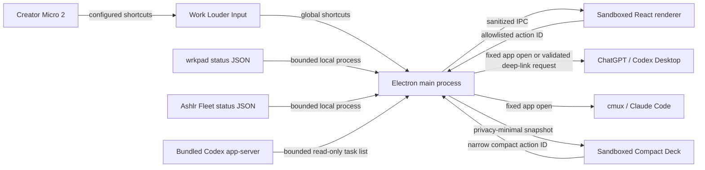

# Architecture and trust boundaries

Ashlr Agent Board is a local macOS observer and guarded action router. The renderer never receives a general shell, filesystem, or process API.

## System context

## Components

### React renderer

`src/` renders the board twin, attention runway, Fleet brief, setup, and Flight
Check. A separate Compact Deck entry renders the movable hardware-optional
six-slot surface. The main renderer requests only methods exposed by
`electron/preload.cjs`; the Compact Deck has a separate narrow
`electron/compact-preload.cjs` bridge.

Both browser windows use context isolation, disable Node integration, and enable
Electron's sandbox. New windows, webviews, unexpected navigation, and renderer
permission requests are denied. Each IPC handler accepts only its expected
window, trusted main frame, and configured local renderer URL.

### Preload and main process

The preload exposes named IPC calls rather than `ipcRenderer`. `electron/main.cjs` owns shortcuts, authorization, process execution, workspace selection, acceptance events, and receipts.

Actions resolve through `electron/action-registry.cjs`; unknown IDs fail closed.
The main process admits configured action requests, hold operations, and token
confirmation only for the exact `ashlr_layer` route. Passive-route attempts
revoke the affected authorization. Software-only Agent-slot focus remains
available because it opens a fixed provider surface without executing a
configured action. Renderer-supplied commands, executable paths, arguments, and
app names are never executed.

The Compact Deck receives exactly six bounded slot projections and hides titles
unless the user enables them. Its numpad and remapped shortcuts are renderer
window key events, not system-wide hooks; they work only while that deck has
focus. Its main-process skill-action gate admits only the four server-owned safe
copy specs for Amplify, Verify, Polish, and Advance. A separate fixed workflow
allowlist admits only Voice, guarded Continue, and Attention: Voice and Attention
return typed staged intents, while guarded Continue copies fixed text. Attention
then resolves the current non-off slot by `error > needs_input > working > unread
> idle` and lowest slot number before using either the fixed-app path or, for a
recent-catalog Codex slot, the same validated deep-link request as the main
window. None of these paths pastes, submits, sends Enter, changes microphone
permission, proves the visible Codex task changed, or claims exact cmux-pane
focus.

The declared board route is a private local preference with only three values:
`unknown`, `codex_native`, and `ashlr_layer`. It never changes device state.
Only `ashlr_layer` may register the 20 global shortcuts. Startup and every route
change re-evaluate receiver ownership; `unknown` and `codex_native` invalidate
the callback generation, unregister every known accelerator, clear Flight Check
and pending approvals, and verify the Electron registration table is empty.
Native preparation and acceptance fail closed while any known shortcut remains.
`electron/codex-micro-diagnostics.cjs` reads at most four recent Codex log
tails, each capped at 512 KiB, and projects only a reason-coded native state,
timestamp, and fixed detail. Raw logs, private paths, task content, and unknown
fields never cross IPC.

The Input diagnostics use fixed Creator Micro 2 cache and log paths, reject
symlinks, and cap each read at 512 KiB. The cache selects the current profile
using `activeProfileId`, then exposes only sanitized labels, a uniquely
observable single layer, and encoder
classification. Runtime output contains only a bounded profile/layer index,
timestamp, freshness, and reason code for the exact unresolved-combination
signal. Neither diagnostic proves device synchronization or physical output.

### Local adapters

`electron/mission-control.cjs` resolves `wrkpad` and `ashlr` from `~/.local/bin`, `~/.npm-global/bin`, `/opt/homebrew/bin`, `/usr/local/bin`, or `/usr/bin`, then starts them without a shell. Runtime callers intentionally do not trust inherited `PATH` entries:

- `wrkpad status --json`, limited to 1.2 seconds;
- `ashlr fleet status --json`, limited to 6.5 seconds.

Each response is limited to 2 MiB. Agent data must use `dev.wrkpad.hasp.state/v1`. Fleet data must contain valid timestamp, daemon, queue, proposal, goal, and mission-brief fields. Timeout, nonzero exit, oversized output, malformed JSON, and schema failure become unavailable or invalid states.

The exact supported shapes, synthetic fixtures, structured validation reasons,
and upgrade policy are documented in [provider compatibility
contracts](provider-contracts.md). Ashlr's Fleet adapter version describes this
app's bounded projection; it is not an upstream schema or authority claim.

Mission snapshots expose only six bounded slot summaries, bounded Fleet facts, source-state labels, and recognized operator notices. Workspace Pulse is a distinct feature and intentionally displays the user-selected workspace path and bounded Git/toolchain facts.

## Provider integration

### Codex

`wrkpad` converts supported Codex lifecycle receipts into provider-neutral slot
states. Selecting one of those hook-only Codex slots runs `open -a ChatGPT` and
makes no task-selection claim. Empty or inactive runway positions may instead be
filled by a bounded, read-only `thread/list` request to the Codex app-server
bundled with the validated ChatGPT installation. Selecting one of those recent
catalog entries dispatches its validated `codex://threads/<id>` deep link through
LaunchServices. A successful dispatch is not evidence that the expected task is
visibly focused. Neither path submits a prompt or approval.

Codex provider lifecycle state and Codex's native Creator Micro control plane
are separate evidence sources. Provider hooks can populate the six-slot runway
while native firmware initialization is unavailable. Conversely, a native HID
connection does not prove provider hook trust or receipt delivery.

### Claude Code and cmux

`wrkpad` converts supported Claude Code hook events into the same state grammar.
Selecting a Claude slot currently runs `open -a cmux`. The app does not yet
correlate that slot with an authorized exact cmux pane and sends no terminal
input. Claude Desktop can be opened separately.

The main process also contains a source-tested, fixed-bundle-path cmux focus
adapter. It accepts only a versioned privacy-safe locator, validates a fresh
cross-session HMAC match and `identify` echo, pins the bounded socket identity
admitted by `capabilities`, verifies a mode-`0600` same-user socket and pins its
device/inode identity, negotiates `system.identify`, `workspace.select`, and
`surface.focus`, and allowlists only workspace/surface focus commands. Exact
focus also requires one fresh, single-use human authorization receipt and an
exact `password` access mode. Current HASP snapshots expose no locator, Agent
Board has no authorization issuer or socket-password enrollment, and production
calls therefore take the ordinary `open -a cmux` fallback without attempting
socket access. The adapter contains no terminal read, write, send-key, paste,
screen-capture, or prompt-submission command.

The inspected cmux `0.62.2` identity payload predates the bundle/app/binary/CLI
provenance fields. Compatibility with that exact version therefore requires the
fixed bundled CLI path, required protocol capabilities, matching caller UUIDs,
and the private pinned socket above. If any newer provenance field is present,
all such fields must be present and exactly match the expected bundle and paths;
partial or mismatched provenance fails closed. This source-tested exception is
not live exact-pane acceptance.

### Ashlr Hub

Agent Board reduces the local Fleet receipt to daemon state, queue counts, proposal count, active goals, operating mode, blocker, next action, and guard state.

This is a status receipt, not proof of remote authority, provider authentication, protected-branch policy, dispatch, release, or acceptance. Fleet pause/resume and daemon stop remain explicit continuous-hold actions delegated to Ashlr Hub.

## Safety invariants

1. AG00–AG05 keep their slot identity across lenses.
2. Focus can foreground a fixed app but cannot send a prompt or terminal input.
3. The renderer supplies an action ID, never a command.
4. Confirm and hold tokens expire after 30 seconds and are tied to window, action, and workspace.
5. Continuous hold duration is validated by the main process.
6. Flight Check clears approvals and suppresses mapped actions and slot focus.
7. Invalid or missing receipts remain invalid or unavailable.
8. Mission snapshots omit session IDs, provider cwd values, prompts, transcripts, tool arguments, and raw payloads.
9. Push, merge, deploy, publish, delete, spend, credential, and permission-approval executors are absent.
10. The screen remains authoritative; physical RGB and firmware transport are not claimed.
11. Native evidence polling may advance only the inferred initialization rung;
    it never records a Settings or physical observation and never accepts an
    attestation.
12. Compact Deck bindings are window-scoped and its skill gate accepts only
    server-owned `safe` + `copy` registry entries.

## Process and local-data boundaries

Tool discovery accepts safe executable names only and rejects path traversal. Inspection processes have a 20-second timeout and bounded displayed output. Terminal actions use a fixed allowlist. Before approval, the main process resolves an absolute executable, binds its canonical path and device/inode together with the selected workspace identity, and shows only a sanitized repository basename. Confirmation re-resolves those identities; the macOS Terminal command repeats fixed `/usr/bin/stat` device/inode guards for both the directory and executable before `exec`. Raw workspace paths never cross the renderer boundary.

The selected workspace is stored under Electron user data. Flight receipts are created only at a user-chosen destination using an exclusive temporary file, atomic rename, and mode `0600`. Mission status is cached for eight seconds. No cloud service, telemetry sender, or updater exists in this repository.

Changes to IPC, executors, schemas, receipt content, hardware writes, or authority controls require tests and architecture review. See [contributing](../CONTRIBUTING.md#hardware-and-provider-changes).
